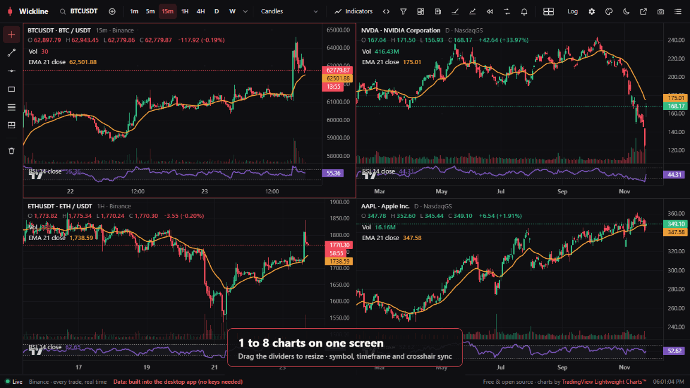

# Wickline

[English](README.md) · [简体中文](README.zh-CN.md) · [繁體中文](README.zh-TW.md) · [日本語](README.ja.md) · [한국어](README.ko.md) · Español · [Português (Brasil)](README.pt-BR.md)

Software de gráficos gratuito y de código abierto (gráficos de velas de acciones y criptomonedas).
- Gráficos en tiempo real de criptomonedas, acciones de EE. UU., España, Latinoamérica y el resto del mundo, ETF, índices, divisas (forex) y futuros, en cualquier temporalidad (2 minutos, 45 minutos, 3 horas…).
- Cadenas de opciones de acciones y ETF de EE. UU., Bitcoin y Ether, con griegas, volatilidad implícita, movimiento esperado y max pain.
- 100 indicadores técnicos integrados; además, puedes escribir tus propios indicadores y estrategias en JavaScript y hacer backtest.
- Herramientas de dibujo, alertas de precio y de 1 a 8 gráficos por pantalla.
- Biblioteca de la comunidad: publica tus scripts para todos y añade los de otros con un clic.
- Screener, mapa de calor (18 mercados de acciones, entre ellos España y Brasil, y criptomonedas), noticias y calendario económico, repetición de barras y trading simulado.
- Sin cuenta, sin claves API y sin suscripción.

**[Descarga la app de escritorio](../../releases/latest)** para Windows, macOS o Linux. Funciona en cuanto la instalas, sin configurar nada.

## Descarga

Descarga el archivo para tu equipo desde la página de [Releases](../../releases/latest):

| Tu equipo | Archivo |
| --- | --- |
| **Windows** | `Wickline-for-Windows-Portable-x.y.z.exe` (sin instalación, solo ejecútalo) o el instalador `Wickline-for-Windows-Setup-x.y.z.exe` |
| **Mac con chip de Apple** (M1, M2, M3, M4 y posteriores) | `Wickline-for-Mac-Apple-Silicon-x.y.z.dmg` |
| Mac con procesador Intel (Mac más antiguos) | `Wickline-Intel-Mac-x.y.z.dmg` |
| Linux | `Wickline-Linux-x.y.z.AppImage` (cualquier distribución) o `Wickline-Linux-x.y.z.deb` (Debian, Ubuntu) |

¿No sabes qué Mac tienes? Menú Apple → “Acerca de este Mac” (“Acerca de esta Mac” en Latinoamérica): si pone “Chip: Apple M…”, es un chip de Apple; si pone “Procesador: … Intel”, es Intel.

### Primer inicio

La app no está firmada digitalmente (los certificados de firma de código son de pago), así que la primera vez aparece un aviso:
- **Windows**: en el mensaje “Windows protegió su PC”, haz clic en “Más información” → “Ejecutar de todas formas”.
- **macOS**: arrastra Wickline a la carpeta “Aplicaciones” y ábrelo. Cuando macOS diga que no puede verificar la app, **no pulses “Trasladar a la papelera”** (“Mover a la papelera” en algunas versiones): pulsa “Cancelar” (o “OK”), ve a “Ajustes del Sistema” (“Configuración del Sistema” en el español de Latinoamérica) → “Privacidad y seguridad”, desplázate hacia abajo y haz clic en “Abrir igualmente”.
- **macOS dice que la app “está dañada”** (versiones anteriores a la 0.1.6): ejecuta `xattr -cr /Applications/Wickline.app` en Terminal.

## Fuentes de datos

Las acciones, ETF, índices, divisas y futuros vienen de Yahoo (incluidas las bolsas de EE. UU., España, México y Brasil), las criptomonedas de Binance, Binance Futures y Coinbase, y las opciones de Bitcoin y Ether de Deribit. Los datos llegan por tu propia conexión a internet, sin pasar por servidores de terceros.

Si Yahoo, Binance o GitHub están bloqueados donde estás, en la app de escritorio ve a ⚙ (Fuentes de datos) → **Proxy de red** y usa el proxy del sistema o un proxy HTTP / SOCKS5 (por ejemplo, el de Clash en `127.0.0.1:7890`). Más detalles, en inglés: [Using a proxy](README.md#using-a-proxy).

## Idioma de la interfaz

La interfaz está en español, English, 简体中文, 繁體中文, 日本語, 한국어 y Português (Brasil), y por defecto sigue el idioma del sistema. Para cambiarlo, haz clic en ⚙ (Fuentes de datos), arriba a la derecha → **Idioma (Language)**, elige uno y pulsa **Guardar**.

## Comentarios

Para preguntas, errores o sugerencias, abre un [issue](../../issues) en español o en inglés.

## Licencia

[MIT](LICENSE). Gratuito y de código abierto.
