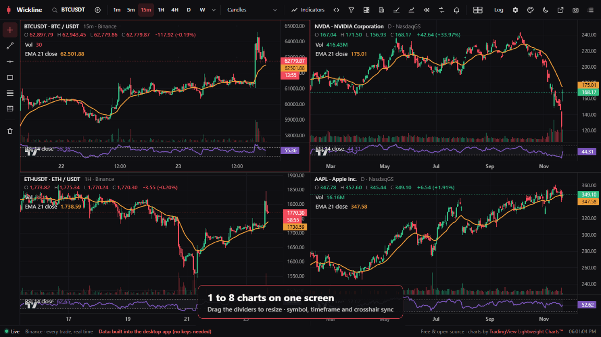

# Wickline

[English](README.md) · [简体中文](README.zh-CN.md) · [繁體中文](README.zh-TW.md) · 日本語 · [한국어](README.ko.md) · [Español](README.es.md) · [Português (Brasil)](README.pt-BR.md)

無料・オープンソースのチャートソフト（株式・暗号資産のローソク足チャート）。
- 暗号資産（仮想通貨）、日本株、米国株、ETF、指数、FX、先物のリアルタイムチャート。時間足は自由に設定できます（2 分足、45 分足、3 時間足…）。
- 米国株・ETF・ビットコイン・イーサリアムのオプションチェーン。グリークス、IV、予想変動幅、マックスペイン付き。
- 100 種類のテクニカル指標を内蔵。JavaScript で自作のインジケーターや売買戦略を作り、バックテストもできます。
- 描画ツール、価格アラート、1 画面に 1〜8 枚のチャート。
- コミュニティスクリプト：自作スクリプトを公開し、他の人のスクリプトをワンクリックで追加。
- スクリーナー、ヒートマップ（日本を含む 18 の株式市場と暗号資産）、ニュースと経済指標カレンダー、バーリプレイ、ペーパートレード。
- アカウント登録、API キー、月額料金はすべて不要です。

**[デスクトップ版をダウンロード](../../releases/latest)**（Windows、macOS、Linux）。インストールしてすぐ使えます。

## ダウンロード

[Releases](../../releases/latest) ページからお使いのパソコンに合ったファイルをダウンロードしてください：

| パソコン | ファイル |
| --- | --- |
| **Windows** | `Wickline-for-Windows-Portable-x.y.z.exe`（インストール不要、そのまま実行）、またはインストーラー `Wickline-for-Windows-Setup-x.y.z.exe` |
| **Apple シリコン搭載の Mac**（M1、M2、M3、M4 以降） | `Wickline-for-Mac-Apple-Silicon-x.y.z.dmg` |
| Intel プロセッサ搭載の Mac（古い Mac） | `Wickline-Intel-Mac-x.y.z.dmg` |
| Linux | `Wickline-Linux-x.y.z.AppImage`（全ディストリビューション）または `Wickline-Linux-x.y.z.deb`（Debian、Ubuntu） |

どちらの Mac かわからない場合：Apple メニュー →「この Mac について」で「チップ: Apple M…」なら Apple シリコン、「プロセッサ: … Intel」なら Intel です。

### 初回起動

有料のコード署名をしていないため、初回だけ警告が表示されます：
- **Windows**：「Windows によって PC が保護されました」と表示されたら、「詳細情報」→「実行」の順にクリック。
- **macOS**：Wickline を「アプリケーション」フォルダにドラッグして開きます。アプリを検証できないという警告が出たら、**「ゴミ箱に入れる」は押さずに**「キャンセル」（または「完了」）を押し、「システム設定」→「プライバシーとセキュリティ」を下にスクロールして「このまま開く」をクリック。macOS 14 以前では、アプリを右クリックして「開く」を選んでも開けます。
- **macOS で「壊れている」と表示される場合**（0.1.6 より前のバージョンを Apple シリコン搭載の Mac で使った場合）：ターミナルで `xattr -cr /Applications/Wickline.app` を実行してください。

## データの取得元

株式・ETF・指数・FX・先物は Yahoo（日本株、米国株、香港株など）、暗号資産は Binance、Binance 先物、Coinbase から、ビットコインとイーサリアムのオプションは Deribit から取得します。データはお使いのネット接続から直接取得し、中継サーバーは経由しません。

Yahoo、Binance、GitHub に直接つながらない環境では、デスクトップ版の ⚙（データソース）→ **ネットワークプロキシ** で、システムのプロキシ、または HTTP / SOCKS5 プロキシ（例：Clash の `127.0.0.1:7890`）を設定できます。詳しくは英語版の [Using a proxy](README.md#using-a-proxy) をご覧ください。

## 表示言語

表示は日本語・English・简体中文・繁體中文・한국어・Español・Português (Brasil) から選べます（初期設定はシステムの言語）。切り替えるには、右上の ⚙（データソース）→ **言語 (Language)** で選び、**保存** を押します。

## フィードバック

質問、不具合の報告、要望は [Issues](../../issues) へ日本語または英語でどうぞ。

## ライセンス

[MIT](LICENSE)。無料・オープンソースです。
