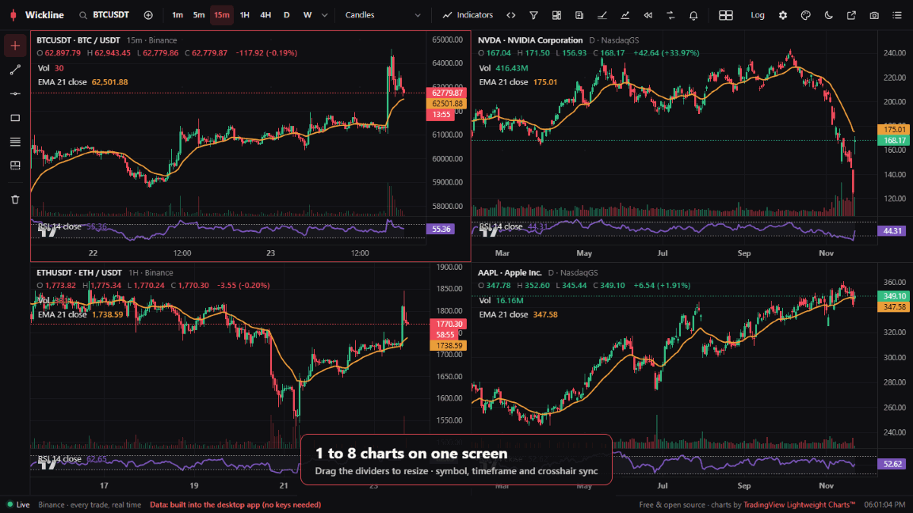

# Wickline

[English](README.md) · [简体中文](README.zh-CN.md) · [繁體中文](README.zh-TW.md) · [日本語](README.ja.md) · 한국어 · [Español](README.es.md) · [Português (Brasil)](README.pt-BR.md)

무료 오픈 소스 차트 프로그램 (주식·코인 캔들 차트).
- 암호화폐(코인), 한국 주식, 미국 주식, ETF, 지수, 외환, 선물 실시간 차트. 주기는 자유롭게 설정할 수 있습니다 (2분봉, 45분봉, 3시간봉…).
- 미국 주식·ETF·비트코인·이더리움 옵션 체인. 그릭스, 내재변동성(IV), 예상 변동폭, 맥스 페인 포함.
- 기술적 지표 100개 내장. JavaScript로 나만의 지표와 매매 전략을 만들고 백테스트도 할 수 있습니다.
- 그리기 도구, 가격 알림, 한 화면에 차트 1~8개.
- 커뮤니티 스크립트: 내 스크립트를 공개하고, 다른 사람의 스크립트를 클릭 한 번으로 추가.
- 스크리너, 히트맵 (한국을 포함한 18개 주식 시장과 암호화폐), 뉴스와 경제 캘린더, 바 리플레이, 모의투자.
- 회원가입, API 키, 구독료가 모두 필요 없습니다.

**[데스크톱 앱 다운로드](../../releases/latest)** (Windows, macOS, Linux). 설치하면 바로 쓸 수 있습니다.

## 다운로드

[Releases](../../releases/latest) 페이지에서 내 컴퓨터에 맞는 파일을 다운로드하세요:

| 컴퓨터 | 파일 |
| --- | --- |
| **Windows** | `Wickline-for-Windows-Portable-x.y.z.exe` (설치 없이 바로 실행) 또는 설치 파일 `Wickline-for-Windows-Setup-x.y.z.exe` |
| **Apple 실리콘 Mac** (M1, M2, M3, M4 이후) | `Wickline-for-Mac-Apple-Silicon-x.y.z.dmg` |
| Intel 프로세서 Mac (구형 Mac) | `Wickline-Intel-Mac-x.y.z.dmg` |
| Linux | `Wickline-Linux-x.y.z.AppImage` (모든 배포판) 또는 `Wickline-Linux-x.y.z.deb` (Debian, Ubuntu) |

어떤 Mac인지 모르겠다면: Apple 메뉴 → "이 Mac에 관하여"에서 "칩: Apple M…"이면 Apple 실리콘, "프로세서: … Intel"이면 Intel입니다.

### 처음 실행하기

유료 코드 서명을 하지 않았기 때문에 처음 한 번만 경고가 나타납니다:
- **Windows**: "Windows의 PC 보호" 창이 나타나면 "추가 정보" → "실행"을 클릭하세요.
- **macOS**: Wickline을 "응용 프로그램" 폴더로 드래그한 다음 엽니다. 확인할 수 없다는 경고가 나타나면 **"휴지통으로 이동"은 누르지 말고** "취소"(또는 "완료")를 누른 다음, "시스템 설정 → 개인정보 보호 및 보안"에서 아래로 스크롤해 "그래도 열기"를 클릭하세요. macOS 14 이하에서는 앱을 Control-클릭(오른쪽 클릭)한 다음 "열기"를 선택해도 됩니다.
- **macOS에서 "손상되었기 때문에 열 수 없습니다"라고 나오는 경우** (Apple 실리콘 Mac, 0.1.6 이전 버전): 터미널에서 `xattr -cr /Applications/Wickline.app`을 실행하세요.

## 데이터 출처

주식·ETF·지수·외환·선물은 Yahoo (한국 주식, 미국 주식, 일본 주식, 홍콩 주식 등), 암호화폐는 Binance, Binance 선물, Coinbase, 암호화폐 히트맵의 시가총액은 CoinGecko, 비트코인과 이더리움 옵션은 Deribit에서 가져옵니다. 데이터는 사용자의 인터넷 연결로 직접 가져오며 중계 서버를 거치지 않습니다.

Yahoo, Binance, GitHub에 직접 연결되지 않는 환경에서는 데스크톱 앱의 ⚙ (데이터 소스) → **네트워크 프록시**에서 시스템 프록시 또는 HTTP / SOCKS5 프록시 (예: Clash의 `127.0.0.1:7890`)를 설정할 수 있습니다. 자세한 내용은 영어 문서의 [Using a proxy](README.md#using-a-proxy)를 참고하세요.

## 표시 언어

한국어, English, 简体中文, 繁體中文, 日本語, Español, Português (Brasil)를 지원하며, 기본값은 시스템 언어를 따릅니다. 언어를 바꾸려면 오른쪽 위의 ⚙ (데이터 소스) → **언어 (Language)** → 원하는 언어 선택 → **저장**을 누르세요.

## 피드백

질문, 버그 신고, 요청 사항은 [Issues](../../issues)에 한국어 또는 영어로 남겨 주세요.

## 라이선스

[MIT](LICENSE). 무료 오픈 소스입니다.
