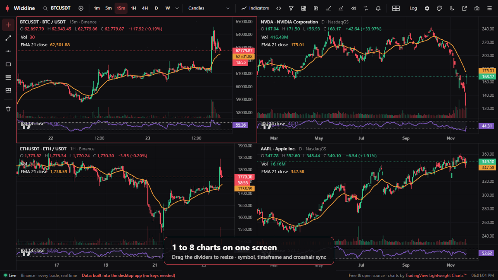

# Wickline

[English](README.md) · 简体中文 · [繁體中文](README.zh-TW.md) · [日本語](README.ja.md) · [한국어](README.ko.md) · [Español](README.es.md) · [Português (Brasil)](README.pt-BR.md)

免费、开源的看盘软件（股票和加密货币 K 线图表）。
- 加密货币、美股、港股、A 股、ETF、指数、外汇和期货的实时行情（部分交易所有延迟），支持任意周期（2 分钟、45 分钟、3 小时……）。
- 美股、ETF、比特币和以太坊的期权链，含希腊值（Greeks）、隐含波动率、预期波动和最大痛点。
- 100 个内置技术指标；也可以用 JavaScript 编写自己的指标和交易策略，并进行回测。
- 画线工具、价格警报，一屏 1 到 8 个图表。
- 社区脚本库：发布你的脚本给所有人用，一键添加别人的脚本。
- 选股器、热力图（18 个股票市场和加密货币）、新闻与财经日历、K 线回放和模拟交易。
- 无需注册账号，无需 API 密钥，不收订阅费。

**[下载桌面版](../../releases/latest)**（Windows、macOS、Linux）。下载即用，无需任何设置。

## 下载

在 [Releases](../../releases/latest) 页面下载适合你电脑的文件：

| 你的电脑 | 文件 |
| --- | --- |
| **Windows** | `Wickline-for-Windows-Portable-x.y.z.exe`（免安装，直接运行），或安装版 `Wickline-for-Windows-Setup-x.y.z.exe` |
| **搭载 Apple 芯片的 Mac**（M1、M2、M3、M4 及更新） | `Wickline-for-Mac-Apple-Silicon-x.y.z.dmg` |
| 搭载 Intel 处理器的 Mac（较旧的 Mac） | `Wickline-Intel-Mac-x.y.z.dmg` |
| Linux | `Wickline-Linux-x.y.z.AppImage`（任何发行版）或 `Wickline-Linux-x.y.z.deb`（Debian、Ubuntu） |

不确定是哪种 Mac？苹果菜单 →“关于本机”：显示“芯片：Apple M…”的是 Apple 芯片，显示“处理器：… Intel”的是 Intel。

### 首次打开

软件没有付费的代码签名，所以第一次打开时系统会提示一次：
- **Windows**：在“Windows 已保护你的电脑”窗口中点“更多信息 → 仍要运行”。
- **macOS**：把 Wickline 拖到“应用程序”文件夹后打开。提示无法验证该应用时，**不要点“移到废纸篓”**，点“取消”（或“完成”），然后打开“系统设置 → 隐私与安全性”，向下滚动，点“仍要打开”。
- **macOS 提示应用“已损坏”**（0.1.6 之前的版本在 Apple 芯片的 Mac 上会出现）：在“终端”中运行 `xattr -cr /Applications/Wickline.app`。

## 数据来源

股票、ETF、指数、外汇和期货行情来自 Yahoo（包括美股、港股、A 股、日股等），加密货币来自 Binance、Binance 合约和 Coinbase，比特币和以太坊期权来自 Deribit。数据通过你自己的网络连接获取，中间不经过任何其他服务器。部分地区的网络无法直接访问这些网站。这种情况下，可以在桌面版中设置网络代理：⚙（数据源）→ **网络代理**，使用系统代理，或手动填写 HTTP / SOCKS5 代理（例如 Clash 的 `127.0.0.1:7890`）。详见英文说明中的 [Using a proxy](README.md#using-a-proxy)。

## 界面语言

界面支持简体中文、繁體中文、English、日本語、한국어、Español 和 Português (Brasil)，默认跟随系统语言。要切换语言，点右上角的 ⚙（数据源）→ **语言 (Language)**，选择后点 **保存**。

## 反馈

欢迎在 [Issues](../../issues) 中用中文或英文提问、报告问题或提出建议。

## 许可证

[MIT](LICENSE)，免费开源。
