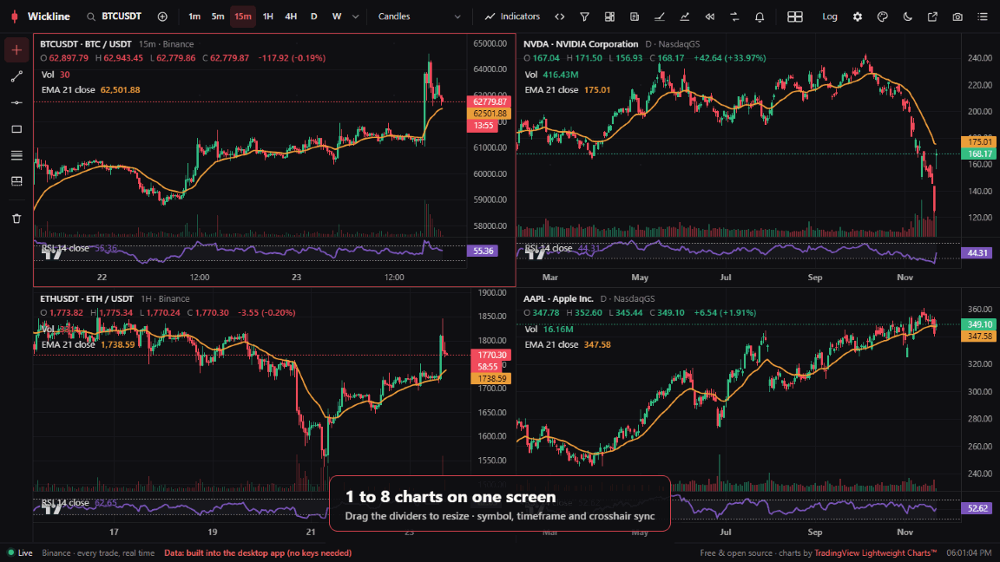

# Wickline

[English](README.md) · [简体中文](README.zh-CN.md) · 繁體中文 · [日本語](README.ja.md) · [한국어](README.ko.md) · [Español](README.es.md) · [Português (Brasil)](README.pt-BR.md)

免費、開源的看盤軟體（股票與加密貨幣K線圖）。
- 加密貨幣、美股、台股、港股、ETF、指數、外匯與期貨的即時行情，支援任意週期（2 分鐘、45 分鐘、3 小時……）。
- 美股、ETF、比特幣與以太幣的選擇權鏈，含希臘字母（Greeks）、隱含波動率、預期波動與最大痛點。
- 100 個內建技術指標；也可以用 JavaScript 撰寫自己的指標與交易策略，並進行回測。
- 繪圖工具、價格警示，一個畫面可放 1 到 8 張圖表。
- 社群腳本庫：發佈你的腳本給所有人使用，一鍵加入別人的腳本。
- 選股器、熱力圖（含台灣在內的 18 個股票市場與加密貨幣）、新聞與財經日曆、K線回放與模擬交易。
- 不需註冊帳號、不需 API 金鑰，也不收訂閱費。

**[下載桌面版](../../releases/latest)**（Windows、macOS、Linux）。下載即可使用，不需任何設定。

## 下載

在 [Releases](../../releases/latest) 頁面下載適合你電腦的檔案：

| 你的電腦 | 檔案 |
| --- | --- |
| **Windows** | `Wickline-for-Windows-Portable-x.y.z.exe`（免安裝，直接執行），或安裝版 `Wickline-for-Windows-Setup-x.y.z.exe`（會加到「開始」功能表） |
| **搭載 Apple 晶片的 Mac**（M1、M2、M3、M4 及更新機型） | `Wickline-for-Mac-Apple-Silicon-x.y.z.dmg` |
| 搭載 Intel 處理器的 Mac（較舊的 Mac） | `Wickline-Intel-Mac-x.y.z.dmg` |
| Linux | `Wickline-Linux-x.y.z.AppImage`（任何發行版）或 `Wickline-Linux-x.y.z.deb`（Debian、Ubuntu） |

不確定是哪一種 Mac？蘋果選單 →「關於這台 Mac」：顯示「晶片：Apple M…」的是 Apple 晶片，顯示「處理器：… Intel」的是 Intel。

### 第一次開啟

本軟體沒有程式碼簽署（簽署憑證需要付費），所以第一次開啟時系統會顯示警告：
- **Windows**：在「Windows 已保護您的電腦」視窗中按「其他資訊」→「仍要執行」。
- **macOS**：將 Wickline 拖到「應用程式」檔案夾後打開。出現無法驗證此 App 的提示時，**不要按「丟到垃圾桶」**，請按「取消」（或「完成」），然後打開「系統設定 → 隱私權與安全性」，向下捲動，按「強制打開」。macOS 14 及更早版本也可以在 App 上按右鍵，選擇「打開」。
- **macOS 顯示 App「已損毀」**（0.1.6 之前的版本在 Apple 晶片的 Mac 上會出現）：在「終端機」中執行 `xattr -cr /Applications/Wickline.app`。

## 資料來源

股票、ETF、指數、外匯與期貨行情來自 Yahoo（包括美股、台股、港股、日股等，部分美股資料來自 Nasdaq），加密貨幣來自 Binance、Binance Futures 與 Coinbase，加密貨幣熱力圖的市值來自 CoinGecko，比特幣與以太幣選擇權來自 Deribit。桌面版內建一個小型資料伺服器，只在你的電腦上（`127.0.0.1`）執行；資料透過你自己的網路連線取得，不經過任何第三方伺服器。

若你所在的網路無法直接連上 Yahoo、Binance 或 GitHub，可以在桌面版中設定網路代理：⚙（資料來源）→ **網路代理**，使用系統代理，或手動填寫 HTTP / SOCKS5 代理（例如 Clash 的 `127.0.0.1:7890`）。詳見英文說明中的 [Using a proxy](README.md#using-a-proxy)。

## 介面語言

介面支援繁體中文、简体中文、English、日本語、한국어、Español 與 Português (Brasil)，預設跟隨系統語言。要切換語言，請按右上角的 ⚙（資料來源）→ **語言 (Language)**，選擇後按 **儲存**。

## 意見回饋

歡迎在 [Issues](../../issues) 中用中文或英文提問、回報問題或提出建議。

## 授權

[MIT](LICENSE)，免費開源。
